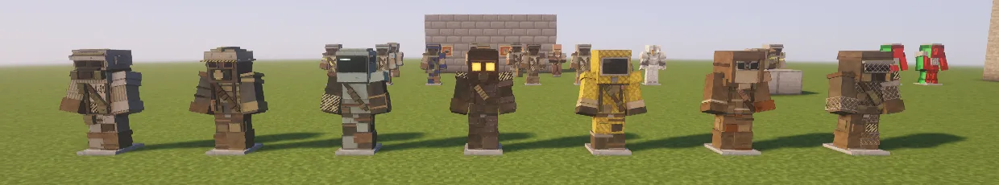
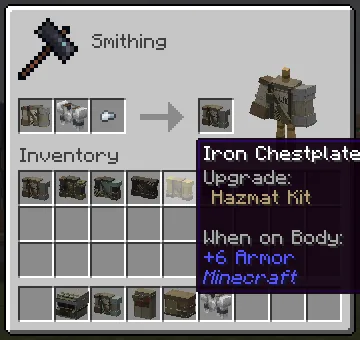
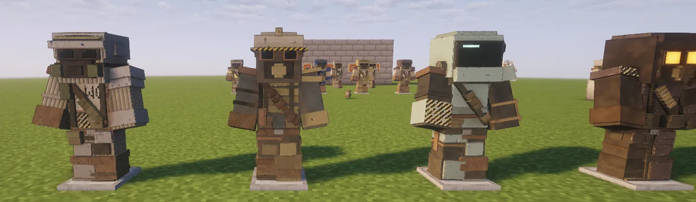
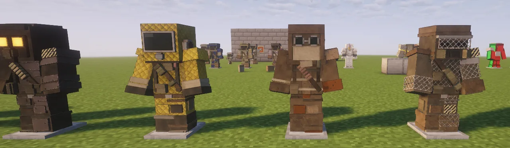
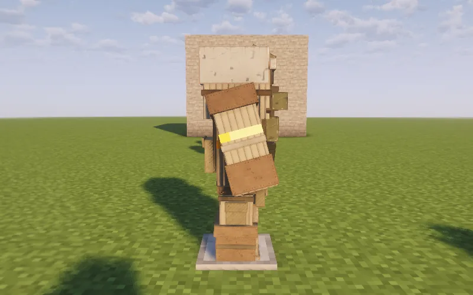
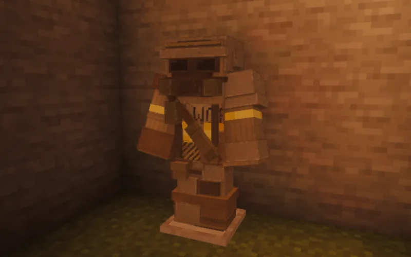
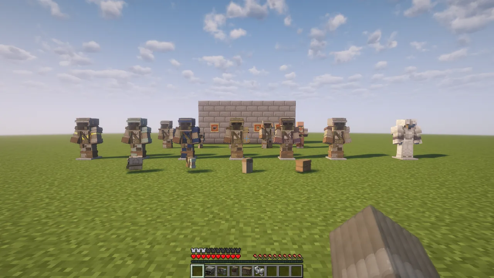

**Survivalist Armor** changes how your armour looks, never what it does. A **kit** is a smithing
template: put it on any helmet, chestplate, leggings or boots at the smithing table, as you would a
trim, and the piece is drawn as a scavenger's version of itself, with real straps, plates, pouches,
filters and bandoliers standing off it. It keeps its armour points, durability, enchantments, name,
dye and trim. Another kit replaces the first, and shears take it off again.

## Getting a kit

Each kit is crafted, cheaply, from scrap and hardware. A kit and two of the item in the last column
make two kits, as a trim template is copied.

| Kit | Crafted from | The scrap the smithing table takes | Copied with | Looks best on |
|---|---|---|---|---|
| **Roadplate** | iron nuggets, a sign, white dye, an iron ingot | an iron nugget | iron ingots | iron |
| **Magpie** | gold nuggets, copper ingots, a lightning rod | a copper ingot | copper ingots | gold |
| **Bluecoat** | leather, glass, prismarine shards | leather | prismarine shards | diamond |
| **Blacklung** | blackstone, coal, blaze powder | coal | blackstone | netherite |
| **Hazmat** | yellow dye, leather, honeycomb, glass | honeycomb | honeycomb | iron |
| **Duster** | leather, string, wool, dried kelp | string | leather | leather |
| **Scrapper** | iron nuggets, chains, tripwire hooks | a chain | chains | chainmail |

EMI shows every recipe: look up a kit, then its uses.

## Putting one on

At a smithing table: the kit in the first slot, the armour piece in the second, the kit's scrap in
the third. The stand beside the result wears it before you take it. The kit is used up, like a trim
template (a server can set it to be kept).

Any piece of armour that takes a trim takes a kit, modded armour included. On a piece of another
material the kit's metal parts take that material: Roadplate's plates are cut steel on iron, brass
on gold, a faded teal composite on diamond, and dark alloy on netherite. On dyed leather they take
the dye.

**To take a kit off**, put the piece and a pair of shears in a crafting grid. You get the piece
back exactly as it was before the kit; the shears lose a point of durability.

## The seven kits

- **Roadplate**: a breastplate cut out of a road sign ("ROAD WORK", worn through), bolted over
  padding; a welding visor flipped up over goggles and a twin-cartridge respirator.
- **Magpie**: brass busbar out of a substation, bent across a lineman's coat; a hard hat, copper
  goggles, a fuse cartridge on the hip, "11KV" sprayed on the back.
- **Bluecoat**: a faded teal hardsuit under scavenged leather; a sealed helmet with a lit visor, a
  tank and hose on the back, a forearm splinted with wood slats.
- **Blacklung**: black lames over a dark coat; a hood, a gas mask with two lit orange eyes, hazard
  shoulders and a brass ammo bandolier.
- **Hazmat**: a quilted yellow chemical suit; a boxy hood with a round filter on its side, a bedroll
  and a canister on the back, coils of red and blue hose.
- **Duster**: a canvas coat over hide; a deep hood with the face in its shadow, a rag over the
  face, welding goggles, a pack, a shotgun-shell bandolier and a spur on one boot.
- **Scrapper**: chain-link fence cut into panels and wired onto a work jacket; a chain-link cage
  over the goggles and an angled twin-cartridge respirator.

Pieces from different kits mix: any kit's helmet, chestplate, leggings and boots fit together
without poking through each other. Every kit is cut close: slim sleeves and bracers, low shoulders,
and nothing on the body where your arms swing.

## Trims, enchantments and your own arm

- **A trim still shows** on a kitted piece: on its cloth and its plates, not on lenses, hoses or
  pouches.
- **Enchanted pieces still shine.**
- **In first person**, your kitted chestplate's sleeve is on your arm, in either hand, without the
  bracers and straps everyone else sees on it, so nothing blocks your view. A player who would rather not
  see it can turn `firstPersonArms` off in the client config.
- With shaders (the pack's Complementary), kits have proper normal and specular maps: metal
  shines, cloth doesn't, and Blacklung's and Bluecoat's lenses glow.

## For server admins

`config/survivalistarmor-server.toml`:

- `blacklist`: a mod's id refuses every piece of that mod, an item's id that piece. Refused pieces
  are turned away at the smithing table and a kit already on one is not drawn. Create's copper and
  netherite backtanks are in it by default: Create draws the tank from a layer of its own, through
  any kit.
- `consumeTemplate`: whether applying a kit uses it up (default yes).
